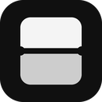
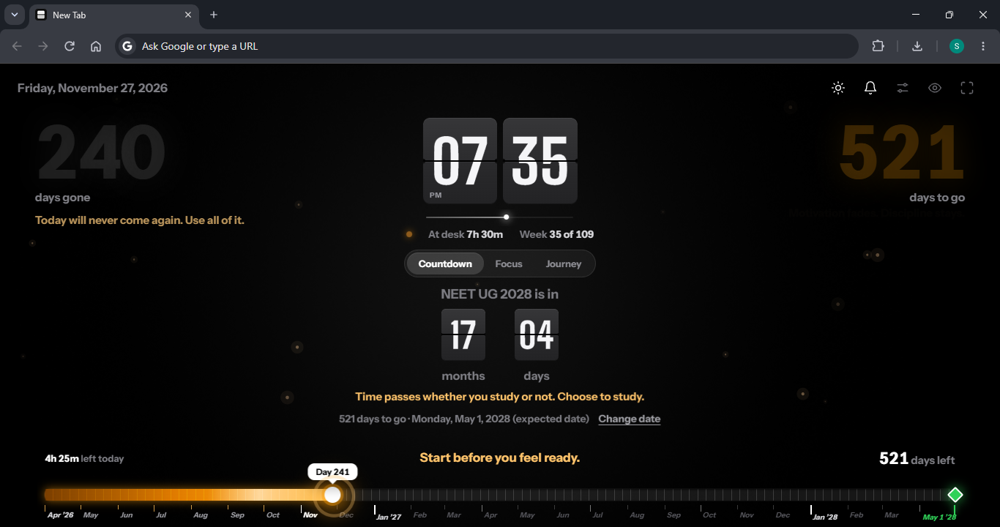
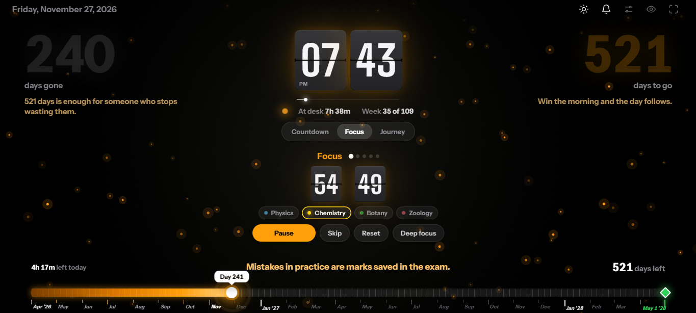

<div align="center">



# NEET 2028 Flip Clock

**A luxury flip-clock new tab for Chrome and Edge, with a Pomodoro focus timer, exam countdown, study journey and gentle reminders.**

[](LICENSE)


[](CONTRIBUTING.md)

</div>

> Every new tab becomes a calm, distraction-free countdown to your exam, with a focus timer built in.


<p align="center">
  
  
</p>


## Features

| | |
|---|---|
| **Flip-clock countdown** | A smooth flip clock counting down to your exam date (default: 1 May 2028, changeable). |
| **Pomodoro focus timer** | 25 / 5 / 15 minute cycles by default, fully adjustable, with a toolbar badge showing minutes left. |
| **Deep Focus mode** | Immersive full-screen timer. Press `D`. |
| **Subject tracking** | Tag sessions as Physics, Chemistry, Botany or Zoology and see time per subject in a colour-coded weekly chart. |
| **Journey view** | Calibrated plan ruler with month, quarter and year marks, plus a day-by-day grid. |
| **Time rail** | Always-visible bar showing where you are in your plan. |
| **Reference dates** | Add your own milestones (mock tests, form dates, and so on). |
| **At-desk time** | Counts device-on time every 30 seconds and pauses while the device sleeps. |
| **Reminders** | A small on-screen card and notifications with motivation lines at an interval you choose. |
| **Chrome and Edge sync** | Optional. Keeps settings, dates, timer and history in step through one **private GitHub gist** on your own account. No server involved. |
| **Backup** | Export and import all settings and history as a single JSON file. |
| **Effects levels** | Full, Light or Off, for older machines or a calmer look. |
| **Keep screen awake** | Optional Screen Wake Lock while the tab is visible. |

## Install

The extension is not on a web store, so you load it in developer mode. It takes about a minute.

### Option A: download a release (easiest)
1. Go to the [Releases](../../releases) page and download `neet-flip-clock-vX.Y.Z.zip`.
2. Unzip it somewhere permanent (Chrome loads it from that folder, so do not delete it).
3. Follow the browser steps below.

### Option B: clone the repository
```bash
git clone https://github.com/YOUR-USERNAME/neet-flip-clock.git
```
The ready-to-load extension is the **`extension/`** folder.

### Chrome
1. Open `chrome://extensions` and turn on **Developer mode** (top right).
2. Click **Load unpacked** and choose the folder that contains `manifest.json`.
3. Open a new tab. Done.

### Microsoft Edge
1. Open `edge://extensions` and turn on **Developer mode** (left side).
2. Click **Load unpacked** and choose the same folder.
3. When Edge asks whether to keep the new tab page from this extension, choose **Keep**.

### Updating
Copy the new files over the same folder and press the reload icon on the extension card. Your settings and history are kept.

**Requirements:** Chrome or Edge 116 or newer (any Chromium browser with Manifest V3 support).

## Keyboard shortcuts

| Key | Action |
|---|---|
| `1` / `2` / `3` | Switch to Countdown / Focus / Journey |
| `Space` | Start or pause the timer (Focus panel and Deep Focus) |
| `D` | Open Deep Focus |
| `S` | Open Settings |
| `F` | Toggle fullscreen |
| `Esc` | Close the current sheet or Deep Focus |
| `←` / `→` | Move between tabs |

You can also double-click empty space to toggle fullscreen.

## Sync between Chrome and Edge (optional)

1. Create a GitHub token with **only** the `gist` scope: <https://github.com/settings/tokens/new?scopes=gist>
2. In Chrome: Settings (`S`) → **Sync Chrome and Edge** → paste the token → **Connect**.
3. In Edge: do the same with the **same** token.

Your data lives in a single private gist named `neet-flip-clock-sync.json` on your GitHub account. Details and safety notes are in [docs/SYNC.md](docs/SYNC.md).

## Privacy

- No analytics, no ads, no tracking, and no server operated by this project.
- Everything is stored locally in your browser (`chrome.storage`).
- The only network traffic is the **optional** sync, which talks to `api.github.com` with your own token.

Full details, including why each permission is needed, are in [PRIVACY.md](PRIVACY.md).

## Project structure

```
neet-flip-clock/
├── extension/        Ready-to-load extension (built output, commit this)
├── source/           Readable source and the build script
│   ├── src/          JS, CSS and HTML templates
│   ├── fonts/        Bundled fonts (SIL OFL)
│   ├── icons/ assets/
│   ├── manifest.json
│   └── build.py
├── docs/             Extra documentation
├── scripts/          Release packaging
└── .github/          Issue templates, PR template, CI
```

## Building from source

No dependencies are needed beyond Python 3.

```bash
python3 source/build.py        # rebuilds ./extension
```

Edit files in `source/src/`, rebuild, then reload the extension in `chrome://extensions`. See [CONTRIBUTING.md](CONTRIBUTING.md) and [docs/ARCHITECTURE.md](docs/ARCHITECTURE.md).

To produce a release zip:

```bash
bash scripts/package.sh        # creates dist/neet-flip-clock-vX.Y.Z.zip
```

## Contributing

Bug reports, ideas and pull requests are welcome. Please read [CONTRIBUTING.md](CONTRIBUTING.md) first and follow the [Code of Conduct](CODE_OF_CONDUCT.md). To report a security problem, see [SECURITY.md](SECURITY.md).

## Changelog

See [CHANGELOG.md](CHANGELOG.md).

## License

Code is released under the [MIT License](LICENSE). Bundled fonts (Big Shoulders and Instrument Sans) are under the SIL Open Font License 1.1, see [THIRD_PARTY_NOTICES.md](THIRD_PARTY_NOTICES.md).

---

<div align="center">
Built with focus, for everyone who is counting down to a big exam. Good luck. 🔥
</div>
